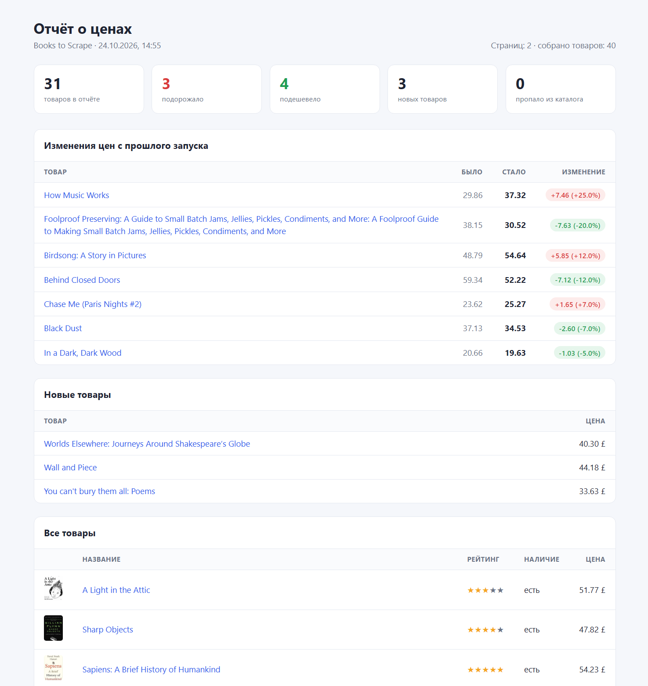
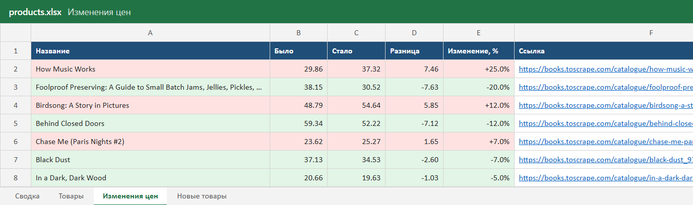
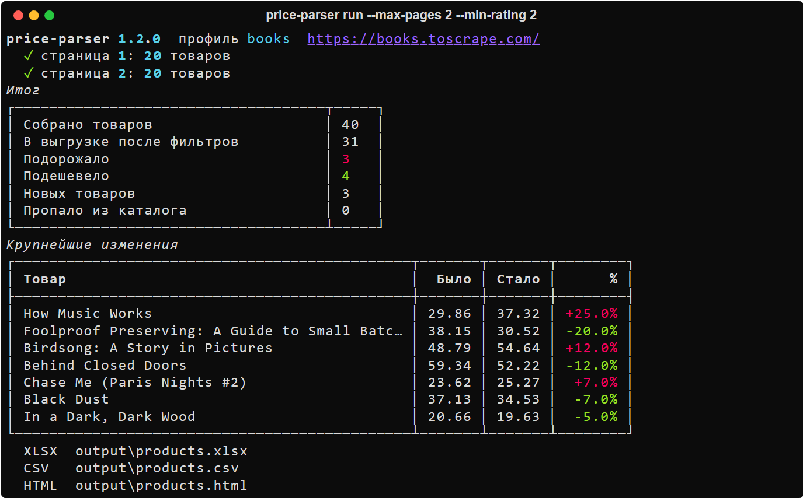
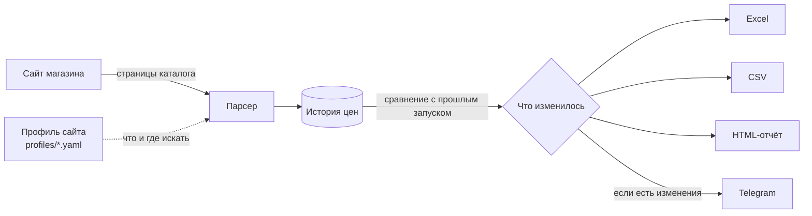

# Мониторинг цен: каталог сайта → Excel, CSV и отчёт

  

## Коротко, без технических слов

Программа сама заходит на сайт магазина, проходит по страницам каталога и собирает названия, цены, рейтинг и наличие товаров. Результат сохраняется в Excel-таблицу и в красивый отчёт, который открывается в браузере.

Главное: программа **помнит цены с прошлого раза**. Запустили сегодня, запустили завтра, и в отчёте сразу видно, что подорожало, что подешевело, какие товары появились и какие пропали. Если нужно, короткая сводка приходит в Telegram.

**Кому полезно:** магазинам, которые следят за ценами конкурентов; закупщикам; тем, кто ведёт каталог и хочет видеть изменения у поставщика.

### Как это выглядит

**Отчёт в браузере.** Сверху сводка, ниже изменения цен (красным подорожание, зелёным снижение), новые товары и полный список с картинками:



**Таблица Excel.** Несколько листов: сводка, все товары, изменения цен с подсветкой, новые товары. Ссылки кликабельные, шапка закреплена, есть фильтры:



**Запуск.** Программа показывает ход работы и итог прямо в окне:



> Скриншоты сняты с настоящего запуска по учебному магазину [books.toscrape.com](https://books.toscrape.com/). Этот сайт специально сделан для практики, и цены на нём не меняются. Поэтому, чтобы показать отчёт об изменениях, цены «вчерашнего» запуска в демонстрационной базе были поправлены вручную. Файлы этого запуска лежат в [`examples/`](examples).

### Как это работает



### Что можно настроить под заказчика

| Что | Как |
|---|---|
| Другой сайт | новый файл-профиль в `profiles/`, код менять не нужно |
| Только нужные товары | фильтры по цене, рейтингу, наличию |
| Как часто проверять | по расписанию (cron, планировщик Windows или Docker) |
| Кого уведомлять | Telegram-чат или группа, порог изменения в процентах |
| Если сайт ограничивает запросы | паузы между запросами, повторы, прокси |

---

## Для разработчика

### Возможности

- **Профили сайтов на YAML.** CSS-селекторы для каждого поля описываются в конфиге и проверяются pydantic-схемой при загрузке
- **HTTP-клиент на httpx:** повторы с экспоненциальной паузой на сетевых ошибках, 429 и 5xx, учёт `Retry-After`, без повторов на 4xx, ограничение частоты, прокси, корректная кодировка без `charset`
- **История в SQLite:** каждый запуск сохраняется отдельно, считаются изменения, новые и пропавшие товары, история отдельно по каждому профилю
- **Выгрузки:** XLSX (openpyxl, несколько листов, форматы чисел, подсветка, гиперссылки), CSV под русский Excel, HTML-отчёт (Jinja2)
- **Защита от CSV-инъекций:** строки с сайта, начинающиеся с `= + - @`, экранируются
- **Уведомления в Telegram** со сводкой и порогом срабатывания
- **CLI на Typer + Rich:** команды `run`, `history`, `runs`, `profiles`
- Строгая типизация (`mypy --strict`), линтер ruff, 28 тестов без доступа к сети

### Быстрый старт

```bash
python -m venv .venv && source .venv/bin/activate   # Windows: .venv\Scripts\activate
pip install -e ".[dev]"
cp .env.example .env
price-parser run --max-pages 3
```

Результат появится в папке `output/`.

### Команды

```bash
price-parser run --profile books --max-pages 0 --min-rating 4 --in-stock --format xlsx,html
price-parser history https://books.toscrape.com/catalogue/sharp-objects_997/index.html
price-parser runs        # последние запуски
price-parser profiles    # какие сайты настроены
```

| Параметр `run` | Что делает |
|---|---|
| `-p, --profile` | профиль сайта из `profiles/` (по умолчанию `books`) |
| `--max-pages N` | сколько страниц обойти, `0` значит все |
| `--min-price`, `--max-price` | диапазон цен для выгрузки |
| `--min-rating 1..5` | минимальный рейтинг |
| `--in-stock` | только товары в наличии |
| `-f, --format` | `xlsx`, `csv`, `html` через запятую |
| `--no-notify` | не отправлять сводку в Telegram |
| `-v` | подробный лог |

### Docker

```bash
docker build -t price-parser .
docker run --rm --env-file .env -v "$PWD/output:/app/output" price-parser run --max-pages 0
```

### Проверки

```bash
pytest          # 28 тестов, сайт подменяется фикстурами
ruff check . && ruff format --check .
mypy
```

### Документация

- [Архитектура и как добавить новый сайт](docs/architecture.md)
- [Развёртывание и запуск по расписанию](docs/deployment.md)

### Структура

```
src/price_parser/
  cli.py            команды командной строки
  pipeline.py       один запуск целиком: загрузка, разбор, история, выгрузки
  http.py           HTTP-клиент с повторами и паузами
  extract.py        разбор HTML по профилю
  profile.py        модель профиля сайта
  storage.py        история цен в SQLite
  notify.py         сводка в Telegram
  exporters/        CSV, XLSX и HTML-отчёт
  templates/        шаблон HTML-отчёта
profiles/           профили сайтов
examples/           результат реального запуска
tests/              pytest + HTML-фикстуры
```
