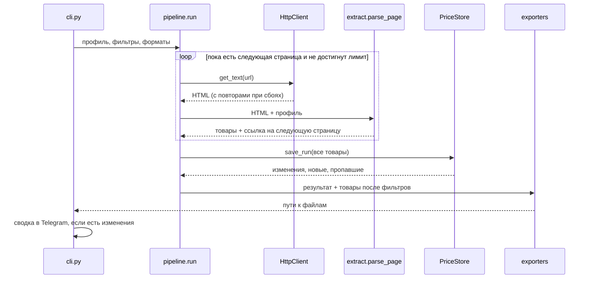

# Архитектура парсера

## Поток данных



## Модули

| Модуль | Ответственность | Зависит от |
|---|---|---|
| `config.py` | настройки из `.env` и окружения (pydantic-settings) | |
| `profile.py` | модель профиля сайта, загрузка и проверка YAML | pydantic, PyYAML |
| `http.py` | загрузка страниц: повторы, паузы, `Retry-After`, кодировка | httpx |
| `extract.py` | превращение HTML в список `Product` по правилам профиля | BeautifulSoup |
| `storage.py` | снимки цен по запускам, подсчёт разницы | sqlite3 |
| `filters.py` | фильтр товаров для выгрузки | |
| `exporters/` | CSV, XLSX, HTML | openpyxl, Jinja2 |
| `notify.py` | текст сводки и отправка в Telegram | httpx |
| `pipeline.py` | склеивает всё в один запуск | все выше |
| `cli.py` | команды и вывод в терминал | Typer, Rich |

Сетевой клиент, хранилище и функция сна передаются в `pipeline.run` и `HttpClient` снаружи. Благодаря этому тесты подменяют сайт через `httpx.MockTransport` и не ждут пауз.

## Решения

**Почему фильтры не влияют на историю.** В базу пишется всё, что собрали. Иначе, если сегодня выгрузить только товары дороже 50, а завтра все, парсер посчитал бы половину каталога «новыми товарами».

**Почему товары сравниваются по ссылке, а не по названию.** Название в каталоге может обрезаться или меняться, а ссылка на карточку стабильна.

**Почему снимок на каждый запуск.** Так можно построить историю цены любого товара (`price-parser history URL`) и понять, какие товары пропали из каталога.

**Дубликаты.** Если один товар встречается на нескольких страницах (например, в блоке «популярное»), он учитывается один раз.

## Как добавить новый сайт

1. Откройте страницу каталога, в инструментах разработчика найдите карточку товара.
2. Создайте `profiles/<имя>.yaml`:

```yaml
title: Магазин инструментов
start_url: https://example.ru/catalog/drills/
item: div.product-card            # карточка товара
next_page: a.pagination__next     # ссылка «следующая страница», можно не указывать

fields:
  title:    { selector: a.product-card__name }
  url:      { selector: a.product-card__name, attr: href, absolute: true }
  price:    { selector: span.price, type: price }        # "1 299 ₽" -> 1299.0 и ₽
  in_stock: { selector: div.stock, type: bool, contains: "в наличии" }
  rating:   { selector: div.rating, attr: data-value, type: int }
  image_url: { selector: img, attr: src, absolute: true }
```

3. Проверьте: `price-parser run -p <имя> --max-pages 1 -v`. Карточки, которые не удалось разобрать, попадут в лог с причиной, остальные будут обработаны.

Обязательные поля: `title`, `url`, `price`. Остальные можно не указывать.

## Ограничения

- Сайты, которые строят каталог JavaScript-ом после загрузки, этим профилем не разобрать: для них нужен браузерный режим (Playwright) или поиск внутреннего API сайта.
- Сайты с капчей и защитой от ботов не обходятся.
- Цены вида `1,299.90` (запятая как разделитель тысяч) сейчас понимаются неверно. Для российских сайтов формат `1 299,90` разбирается правильно.
