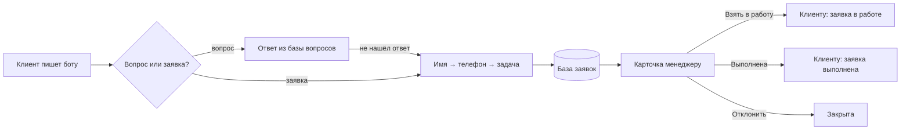

# Telegram-бот для заявок: ответы клиентам и работа менеджера

   

## Коротко, без технических слов

Бот работает как администратор на входе, только круглосуточно.

**Для клиента:** отвечает на частые вопросы (цена, сроки, оплата, гарантия), даже если вопрос написан своими словами. Если клиент готов оставить заявку, бот за три шага спрашивает имя, телефон и задачу. Телефон можно отправить одной кнопкой.

**Для менеджера:** заявка мгновенно приходит в Telegram карточкой с кнопками «Взять в работу», «Выполнена», «Отклонить». Клиент автоматически получает сообщение, когда его заявку взяли в работу. В любой момент можно посмотреть статистику или скачать все заявки в Excel.

**Кому подходит:** салонам, студиям, сервисам, онлайн-школам, мастерам на выезде: всем, кому пишут в Telegram и кто теряет заявки в переписке.

### Как это выглядит

Слева то, что видит клиент. Справа то, что видит менеджер: карточка заявки (уже взята в работу) и статистика по команде `/stats`.


> Переписка сгенерирована скриптом [`scripts/render_demo.py`](scripts/render_demo.py): он прогоняет сценарий через настоящий код бота без подключения к Telegram, перехватывает ответы и рисует их в виде чата. Тексты, кнопки и карточки на картинке именно те, что отправляет бот.

### Путь заявки



### Что можно настроить без программиста

| Что | Где |
|---|---|
| Вопросы и ответы | файл `faq.json` |
| Название компании в приветствии | `BUSINESS_NAME` в `.env` |
| Кто получает заявки | `ADMIN_IDS` в `.env` (можно несколько человек) |
| Защита от спама | `MAX_LEADS_PER_DAY`: сколько заявок один человек может оставить за сутки |
| Все остальные тексты | `src/lead_bot/texts.py`, собраны в одном месте |

### Команды менеджера

| Команда | Что делает |
|---|---|
| `/new` | необработанные заявки с кнопками |
| `/leads` | последние заявки |
| `/stats` | заявки за сутки, неделю, всего, по статусам, доля успешных |
| `/export` | файл со всеми заявками для Excel |

Клиенты эти команды не видят и вызвать не могут.

---

## Для разработчика

### Возможности

- **aiogram 3:** роутеры по зонам ответственности, FSM для формы, `CallbackData` для кнопок, фильтр администратора, внедрение зависимостей через workflow data диспетчера
- **SQLAlchemy 2.0 async:** SQLite по умолчанию, PostgreSQL через `DATABASE_URL` (в `docker-compose.yml` уже настроен)
- **Статусы заявки:** новая → в работе → выполнена / отклонена, с фиксацией менеджера; клиент получает уведомления о смене статуса
- **Надёжность:** заявка сохраняется до отправки уведомления; если менеджер заблокировал бота, заявка не теряется, ошибка пишется в лог; глобальный обработчик ошибок
- **Защита:** лимит заявок на пользователя в сутки, экранирование HTML во всём пользовательском вводе, экранирование формул в CSV
- **Проверка ввода:** имя (буквы, дефис, апостроф), телефон в любом формате → `+7XXXXXXXXXX`
- **Поиск по FAQ** с учётом окончаний слов
- Меню команд отдельно для клиентов и для менеджеров
- `mypy --strict`, ruff, 35 тестов

### Быстрый старт

```bash
python -m venv .venv && source .venv/bin/activate   # Windows: .venv\Scripts\activate
pip install -e ".[dev]"
cp .env.example .env          # впишите BOT_TOKEN и ADMIN_IDS
lead-bot
```

Менеджер должен один раз нажать `/start` у бота, иначе Telegram не разрешит боту ему написать.

### Docker + PostgreSQL

```bash
cp .env.example .env
docker compose up -d --build
docker compose logs -f bot
```

### Проверки

```bash
pytest          # 35 тестов, токен и сеть не нужны
ruff check . && ruff format --check .
mypy
python scripts/render_demo.py docs/demo   # перерисовать демо-переписку
```

Тесты прогоняют целые сценарии через `Dispatcher.feed_update`, а запросы к Telegram API перехватываются в [`tests/harness.py`](tests/harness.py): заявка от `/start` до карточки менеджера, отправка номера кнопкой, ошибки ввода, отмена, лимит заявок, смена статусов с уведомлением клиента, заблокированный менеджер, FAQ, закрытые команды, выгрузка CSV.

### Документация

- [Архитектура](docs/architecture.md)
- [Развёртывание на сервере](docs/deployment.md)

### Структура

```
src/lead_bot/
  __main__.py        запуск (polling)
  app.py             сборка бота и диспетчера, меню команд
  config.py          настройки из .env
  db.py              модель заявки, статусы, репозиторий
  services.py        проверка ввода, FAQ, выгрузка CSV
  texts.py           все тексты бота
  keyboards.py       клавиатуры и кнопки статусов
  handlers/
    common.py        /start, отмена, контакты
    lead_form.py     форма заявки
    admin.py         команды и кнопки менеджера
    faq.py           ответы на вопросы
faq.json             вопросы и ответы
scripts/             демо-переписка
tests/               сценарии и юнит-тесты
```
