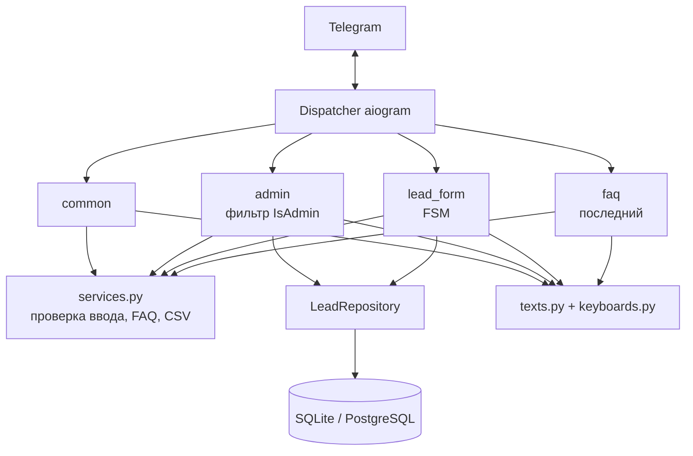
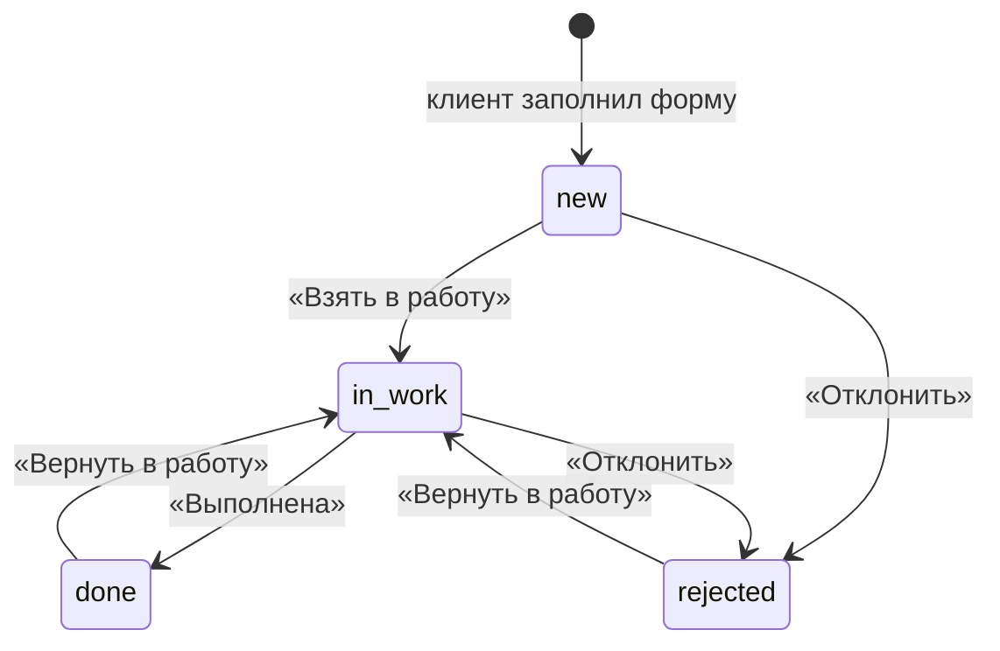

# Архитектура бота

## Слои

Обработчики не создают зависимости сами. `Settings`, `LeadRepository` и `Faq` передаются в `Dispatcher(...)` и подставляются aiogram по имени аргумента. Поэтому в тестах тот же код работает с базой в памяти, а в продакшене с PostgreSQL.

Роутеры собираются фабриками `make_router()`, а не создаются при импорте модуля. Так в одном процессе можно поднять несколько независимых диспетчеров (это нужно тестам и скрипту демо-переписки).

## Порядок роутеров

1. `common`: `/start`, отмена и контакты работают в любом состоянии
2. `admin`: команды и кнопки менеджера, недоступны обычным пользователям
3. `lead_form`: шаги формы, срабатывают только в нужном состоянии FSM
4. `faq`: всё остальное текстом считается вопросом; неизвестные команды получают подсказку

## Жизненный цикл заявки

При переходе в `in_work` и `done` клиент получает сообщение. Набор кнопок под карточкой зависит от текущего статуса (`keyboards._NEXT`).

## Модель данных

| Поле | Тип | Описание |
|---|---|---|
| `id` | int | номер заявки |
| `user_id`, `username` | bigint, str | кто оставил |
| `name`, `phone`, `comment` | str | данные формы, телефон в формате `+7XXXXXXXXXX` |
| `status` | enum | `new`, `in_work`, `done`, `rejected` |
| `manager_id` | bigint | кто последним менял статус |
| `created_at`, `updated_at` | timestamptz | хранятся в UTC, показываются в `TIMEZONE` |

Таблица создаётся при запуске. При изменении схемы в рабочем проекте стоит подключить Alembic.

## Решения

**Сначала сохранить, потом уведомить.** Если отправка менеджеру упала (заблокировал бота, сбой сети), заявка уже в базе и видна в `/new` и `/export`.

**Лимит заявок в сутки.** Защищает менеджера от спама и от клиента, который нажимает «Оставить заявку» несколько раз подряд.

**Состояние формы в памяти.** Используется стандартный `MemoryStorage`: при перезапуске бота незаконченные формы сбрасываются. Если нужно переживать перезапуски, достаточно подключить `RedisStorage` в `app.create_dispatcher`.
