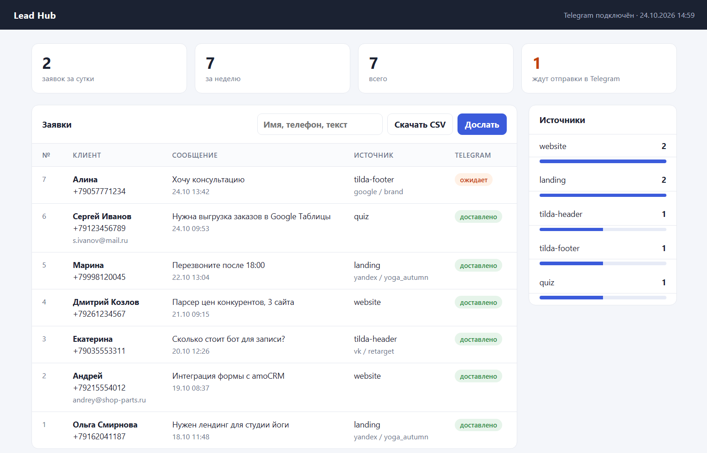
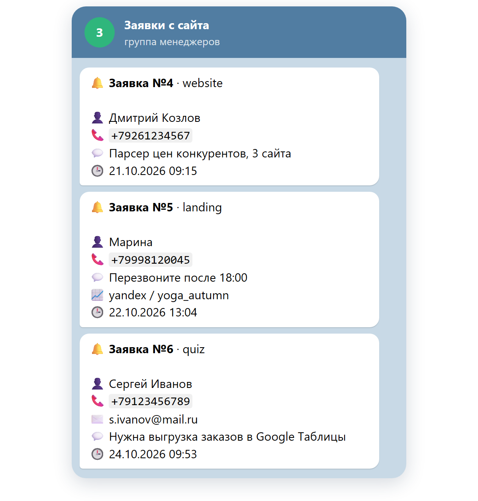
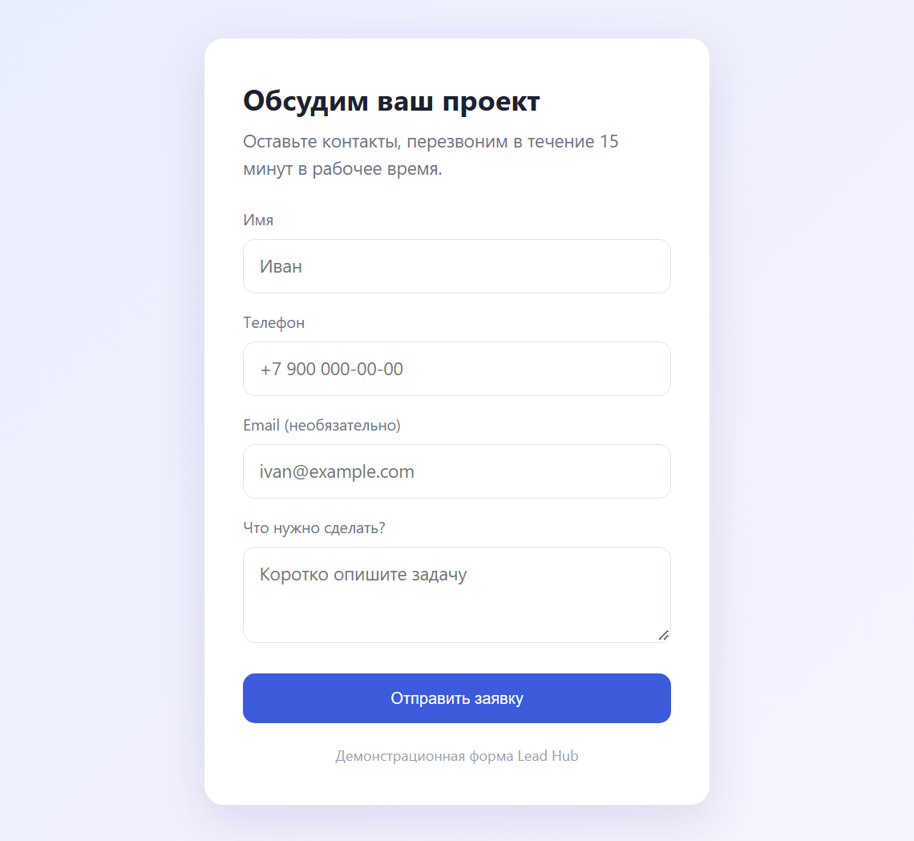
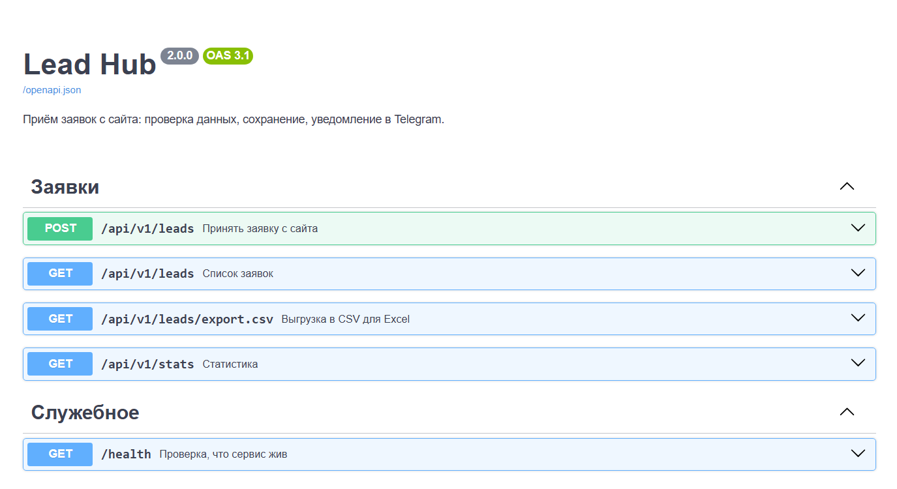
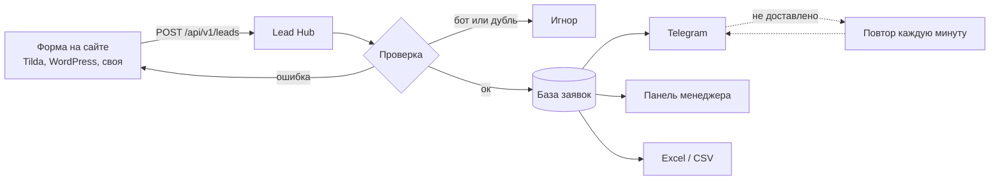

# Lead Hub: заявки с сайта → Telegram и панель менеджера

   

## Коротко, без технических слов

Посетитель заполняет форму на сайте. Через секунду заявка приходит менеджеру в Telegram, а заодно сохраняется в базу. Ни одна заявка не теряется: если Telegram в этот момент недоступен, сервис дошлёт её позже сам.

Для менеджера есть **панель в браузере**: все заявки, поиск, откуда пришёл клиент (какая форма, какая реклама), выгрузка в Excel.

Работает с формами на **Tilda**, WordPress, конструкторах сайтов и с любой самописной формой. Спам-боты отсеиваются, повторные нажатия кнопки «Отправить» не создают дублей.

### Как это выглядит

**Панель менеджера.** Сверху счётчики, ниже все заявки с источником и рекламной кампанией. Оранжевым отмечена заявка, которая пока не ушла в Telegram, кнопка «Дослать» отправит её вручную:



<table>
<tr>
<td width="50%"><b>Уведомления в Telegram.</b> Имя, телефон, сообщение и рекламная метка в одной карточке:<br><br></td>
<td width="50%"><b>Демо-форма</b>, которую можно встроить на сайт или взять как пример:<br><br></td>
</tr>
</table>

**Документация API** генерируется автоматически, по ней программист заказчика подключит любую форму:



> Панель и документация API сняты с локально запущенного сервиса. Заявки отправлены через его API тестовыми запросами. Уведомления показаны в виде чата: это тексты, которые сервис сформировал для Telegram.

### Как это работает



### Что получает заказчик

| | |
|---|---|
| Скорость | заявка в Telegram через секунду после отправки формы |
| Надёжность | сначала сохранение, потом отправка; недоставленные досылаются автоматически |
| Аналитика | источник заявки и UTM-метки рекламы (Яндекс, VK, Google) в карточке и в выгрузке |
| Защита | ключ доступа, ловушка для ботов, ограничение частоты запросов, защита от дублей |
| Удобство | панель с поиском, выгрузка в Excel одной кнопкой, понятные ошибки на русском под формой |

---

## Для разработчика

### Возможности

- **FastAPI**: API `/api/v1`, автодокументация OpenAPI, единый формат ошибок валидации на русском
- **Приём JSON и `x-www-form-urlencoded`**, сопоставление полей разных конструкторов (`Name`, `fio`, `Phone`, `tel`, `Comments`, `formname` и т.п.), поддержка проверочного запроса Tilda
- **Ключ API** в заголовке `X-API-Key` или параметре `?key=` (для конструкторов, которые не умеют в заголовки), сравнение за постоянное время; сервис не стартует со слабым ключом
- **Антиспам:** honeypot-поле, rate limit по IP (скользящее окно), защита от двойной отправки по телефону за 10 минут
- **Доставка:** уведомление после сохранения, счётчик попыток и последняя ошибка в базе, фоновая задача досылает недоставленное, ручная досылка из панели
- **Панель `/admin`** (HTTP Basic): счётчики, поиск, пагинация, источники, CSV
- **SQLAlchemy 2.0 async**: SQLite по умолчанию, PostgreSQL в `docker-compose.yml`; поиск по кириллице без учёта регистра работает и на SQLite
- Экранирование формул в CSV, HTML-экранирование в уведомлениях
- `mypy --strict`, ruff, 25 тестов

### API

| Метод | Путь | Описание |
|---|---|---|
| `POST` | `/api/v1/leads` | принять заявку (JSON или форма) |
| `GET` | `/api/v1/leads?limit=&offset=&search=` | список заявок |
| `GET` | `/api/v1/leads/export.csv` | выгрузка для Excel |
| `GET` | `/api/v1/stats` | счётчики и источники |
| `GET` | `/health` | состояние сервиса и очередь недоставленных |
| `GET` | `/admin` | панель менеджера |
| `GET` | `/docs` | документация OpenAPI |

```bash
curl -X POST "http://localhost:8000/api/v1/leads" \
  -H "X-API-Key: $API_KEY" -H "Content-Type: application/json" \
  -d '{"name": "Иван Петров", "phone": "8 912 345-67-89", "message": "Нужен бот", "utm_source": "yandex"}'
```
```json
{"ok": true, "id": 1, "duplicate": false}
```

Ошибка проверки, готовая к показу пользователю:

```json
{
  "detail": "Проверьте поля формы",
  "errors": [
    {"field": "name", "message": "Имя: слишком короткое значение"},
    {"field": "phone", "message": "Телефон: некорректный номер телефона, нужен российский номер"}
  ]
}
```

### Быстрый старт

```bash
python -m venv .venv && source .venv/bin/activate   # Windows: .venv\Scripts\activate
pip install -e ".[dev]"
cp .env.example .env      # обязательно API_KEY, для панели ADMIN_PASSWORD
uvicorn lead_hub.main:get_app --factory --reload
```

Откройте `http://localhost:8000/docs`. С `DEMO_FORM=true` форма будет на `http://localhost:8000/demo?key=<API_KEY>`.

### Docker + PostgreSQL

```bash
docker compose up -d --build
curl localhost:8000/health
```

### Проверки

```bash
pytest          # 25 тестов, Telegram подменяется
ruff check . && ruff format --check .
mypy
```

### Документация

- [Подключение к Tilda, WordPress и своей форме](docs/integration.md)
- [Архитектура](docs/architecture.md)
- [Развёртывание с HTTPS](docs/deployment.md)

### Структура

```
src/lead_hub/
  main.py         сборка приложения, фоновая досылка
  api.py          публичный API
  admin.py        панель менеджера
  schemas.py      модели запросов, сопоставление полей форм
  db.py           модель заявки и репозиторий
  services.py     доставка уведомлений, CSV
  notifier.py     отправка в Telegram, текст карточки
  security.py     ключ API, вход в панель, rate limit
  errors.py       ошибки валидации на русском
  templates/      HTML панели
  static/         демо-форма
tests/
```
