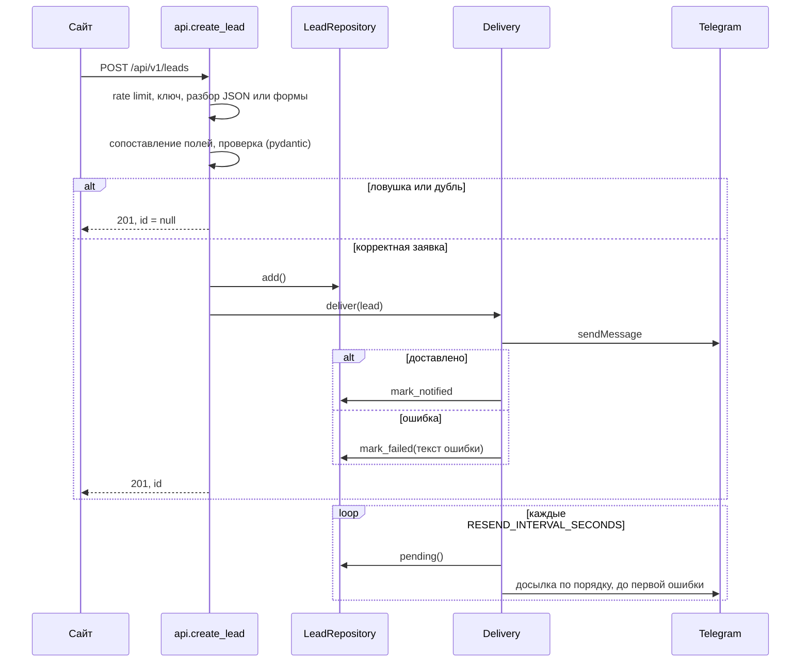

# Архитектура Lead Hub

## Обработка заявки

Ответ сайту не зависит от того, дошло ли уведомление: заявка уже сохранена, а досылка идёт в фоне.

## Модули

| Модуль | Ответственность |
|---|---|
| `main.py` | фабрика приложения: настройки, база, notifier, фоновая задача в `lifespan`, CORS, маршруты |
| `api.py` | публичные эндпоинты |
| `admin.py` | HTML-панель на Jinja2 |
| `schemas.py` | входные и выходные модели, словарь синонимов полей |
| `db.py` | модель `Lead`, репозиторий на SQLAlchemy async |
| `services.py` | `Delivery` (отправка и досылка), выгрузка CSV |
| `notifier.py` | протокол `Notifier`, реализация для Telegram, текст карточки |
| `security.py` | ключ API, HTTP Basic для панели, `RateLimiter` |
| `errors.py` | перевод ошибок валидации в понятные сообщения |

Зависимости (`Settings`, репозиторий, `Delivery`, `RateLimiter`) лежат в `app.state` и достаются через `Depends`. Notifier передаётся в `create_app` снаружи: в тестах это заглушка, в работе `TelegramNotifier`.

## Модель данных

| Поле | Описание |
|---|---|
| `name`, `phone`, `email`, `message` | данные формы, телефон в формате `+7XXXXXXXXXX` |
| `source`, `page_url` | с какой формы и страницы |
| `utm_source`, `utm_medium`, `utm_campaign` | рекламные метки |
| `ip` | адрес отправителя |
| `created_at` | время в UTC |
| `notified_at`, `notify_attempts`, `last_error` | состояние доставки в Telegram |
| `search_text` | имя, телефон, email и текст в нижнем регистре для поиска |

## Решения

**Почему `search_text`.** В SQLite `LOWER` и `LIKE` без учёта регистра работают только для латиницы, поэтому поиск «бор» не находил «Борис». Отдельное поле в нижнем регистре решает это одинаково для SQLite и PostgreSQL.

**Почему досылка останавливается на первой ошибке.** Если Telegram недоступен, нет смысла пытаться отправить сто заявок подряд. Следующая попытка будет через интервал.

**IP для rate limit.** Берётся из соединения, а не из заголовка `X-Forwarded-For`: иначе ограничение обходится подстановкой заголовка. За nginx реальный адрес подставляет uvicorn (`--proxy-headers`, доверенный прокси задаётся `--forwarded-allow-ips`).

**Ограничения.** Rate limit хранится в памяти процесса: при нескольких воркерах лимит считается для каждого отдельно (для общего лимита нужен Redis). Схема базы создаётся при старте; для изменений схемы в рабочем проекте стоит подключить Alembic.
