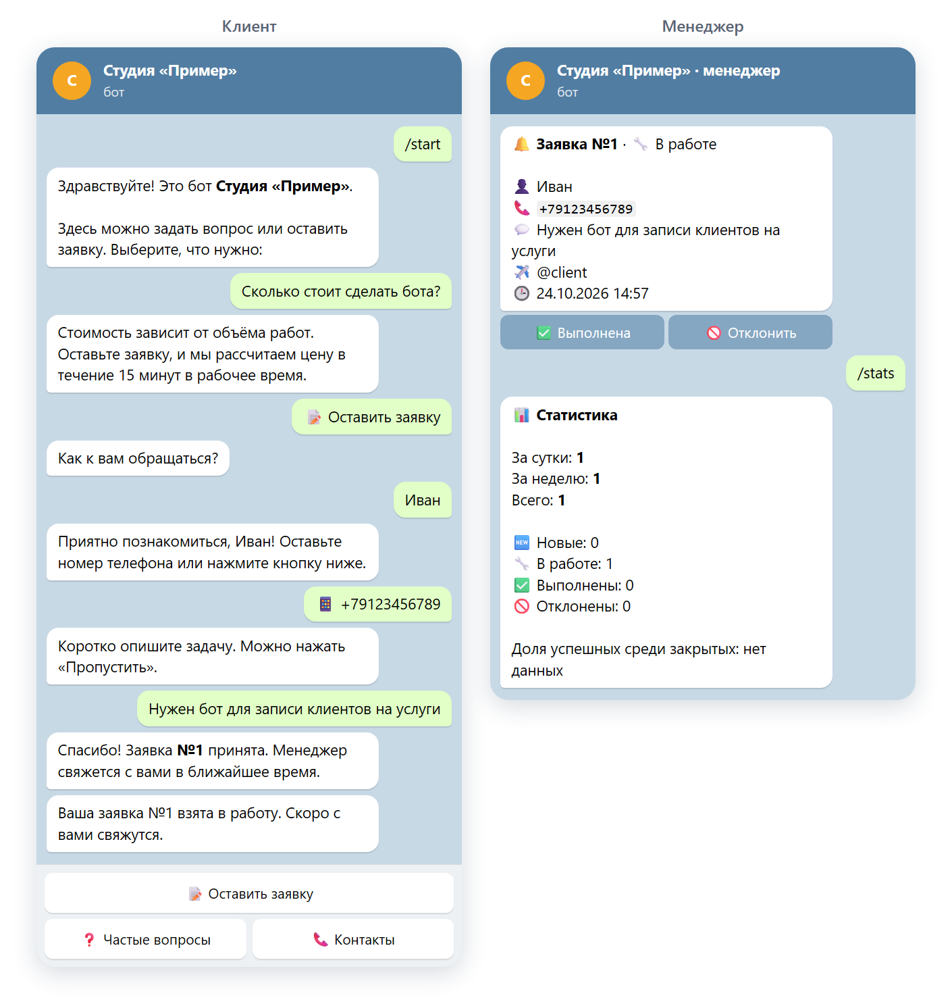

# Автоматизация для бизнеса на Python

[](https://github.com/turbovanya/freelance-portfolio-python/actions/workflows/tests.yml)


Меня зовут Иван. Я делаю программы, которые экономят время: собирают данные с сайтов, принимают заявки и отвечают клиентам в Telegram, связывают сайт с мессенджерами и таблицами.

Ниже три готовых проекта. У каждого есть описание простыми словами и скриншоты, так что разобраться можно без знания программирования. Для технических специалистов в каждом проекте есть отдельный раздел с архитектурой, запуском и тестами.

---

## 1. [Мониторинг цен конкурентов](01-price-parser)

**Задача:** каждый день вручную проверять цены у конкурентов или поставщиков долго и скучно.

**Решение:** программа сама обходит каталог сайта, собирает цены и наличие, сохраняет в Excel и в отчёт для браузера. Главное: она сравнивает с прошлым запуском и показывает, что подорожало, подешевело, появилось или пропало. Сводка может приходить в Telegram.

[](01-price-parser)

`Python` · `httpx` · `BeautifulSoup` · `openpyxl` · `SQLite` · `Jinja2` · `Typer` · `Docker`

---

## 2. [Telegram-бот для приёма заявок](02-telegram-lead-bot)

**Задача:** клиенты пишут в мессенджер в любое время, заявки теряются в переписке, на одни и те же вопросы приходится отвечать снова и снова.

**Решение:** бот отвечает на частые вопросы, собирает заявку (имя, телефон, задача) и сразу присылает её менеджеру карточкой с кнопками «Взять в работу», «Выполнена». Клиент получает уведомление о статусе, менеджер видит статистику и выгружает заявки в Excel.

[](02-telegram-lead-bot)

`Python` · `aiogram 3` · `SQLAlchemy 2` · `PostgreSQL` · `Docker`

---

## 3. [Заявки с сайта в Telegram и панель менеджера](03-webhook-lead-notifier)

**Задача:** заявки с формы на сайте приходят на почту с опозданием или теряются, непонятно, какая реклама их приносит.

**Решение:** сервис принимает форму с любого сайта (Tilda, WordPress, свой), проверяет данные, отсеивает спам и за секунду присылает заявку в Telegram. Если Telegram недоступен, заявка сохраняется и досылается позже. В панели видны все заявки, источники и рекламные метки, выгрузка в Excel.

[](03-webhook-lead-notifier)

`Python` · `FastAPI` · `SQLAlchemy 2` · `PostgreSQL` · `Docker`

---

## Как я делаю проекты

- **Работает без сюрпризов.** Сбои сети, неправильный ввод и спам предусмотрены заранее: программа не падает и не теряет данные
- **Настройки без программиста.** Тексты, вопросы, получатели уведомлений и параметры вынесены в понятные файлы
- **Проверено тестами.** В каждом проекте автотесты (всего 88), они запускаются автоматически при каждом изменении кода
- **Легко запустить.** Инструкция для Windows и для сервера, Docker для запуска одной командой
- **Документация.** Описание для заказчика, архитектура и инструкция по развёртыванию

## Для разработчиков

Каждый проект независимый: свой `pyproject.toml`, `Dockerfile`, тесты и документация.

```bash
cd 01-price-parser            # или 02-telegram-lead-bot, 03-webhook-lead-notifier
pip install -e ".[dev]"
pytest && ruff check . && mypy
```

Общее для всех: Python 3.11+, строгая типизация (`mypy --strict`), ruff, pydantic-settings для конфигурации, секреты только в `.env`, CI на GitHub Actions.

Лицензия MIT.
